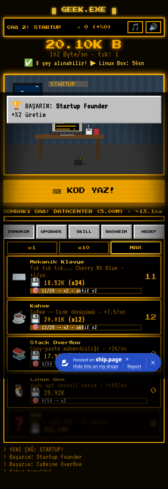
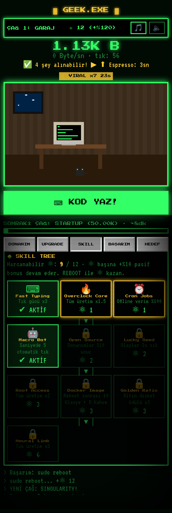
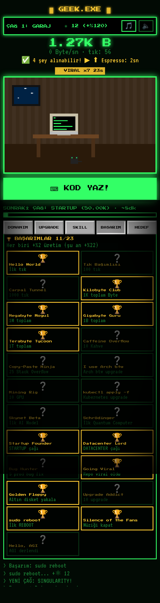

# ▓ GEEK.EXE ▓ — Retro Geek Idle Oyunu

Yatak odasındaki tek bir **8086 PC** ile kod yazmaya başla, **AGI**'yi derleyip **Singularity**'ye ulaş! CRT ekranlı, pixel art, mobil öncelikli, Türkçe bir idle/incremental oyun.

🎮 **Oyna:** https://brkse.github.io/geek-idle/

| Oyun | Skill Tree | Başarımlar |
|---|---|---|
|  |  |  |

## Özellikler
- 📺 Retro CRT görünüm: scanline, fosfor ışıltısı, Press Start 2P / VT323 pixel fontları, Win95 pencereleri
- 🏠 Büyüyen pixel sahne: aldığın her donanım odaya animasyonlu obje olarak ekleniyor
- ⌨️ 10 donanım: Mekanik Klavye → Kahve → Stack Overflow → Linux → GPU → Server Rack → Cloud → AI → Quantum → Dyson Datacenter
- 🕰️ 5 çağ: Garaj → Startup → Datacenter → AI Lab → Singularity, her çağda yeni renk paleti ve müzik temposu
- 🎯 Milestone bonusları (10/25/50/100… adette x2), 19 upgrade, x1/x10/MAX toplu alım, "sonraki hedef" ipuçları
- 🐛 Rastgele olaylar: Prod'da bug, Repo viral oldu (x7), Hackathon, Altın disket, Kahve molası
- 🏆 23 geek esprili başarım (her biri +%2)
- ♻️ REBOOT (prestige) + ⚛ Quantum Bit ile 10 yetenekli Skill Tree
- 🎵 WebAudio chiptune müzik ve efektler (ayrı aç/kapa)
- 💾 Otomatik kayıt (localStorage) ve offline kazanç

## Denge (simülasyon)
Aktif oyuncu (5 tık/sn, açgözlü alım) — `node tools/sim.js`:

| Koşu | Startup | Datacenter | AI Lab | Singularity | AGI |
|---|---|---|---|---|---|
| 1. koşu | 3.3 dk | 12.9 dk | 40.3 dk | 108 dk | 162 dk |
| 2. koşu (10 ⚛) | 1.7 dk | 6.0 dk | 17.3 dk | 44 dk | 65.5 dk |

## Teknik
Tek dosya: düz HTML/CSS/JS, build adımı yok. `tools/` içinde denge simülasyonu ve Playwright mobil testleri var (`npm i playwright && node tools/t3.js file://$PWD/index.html`).
